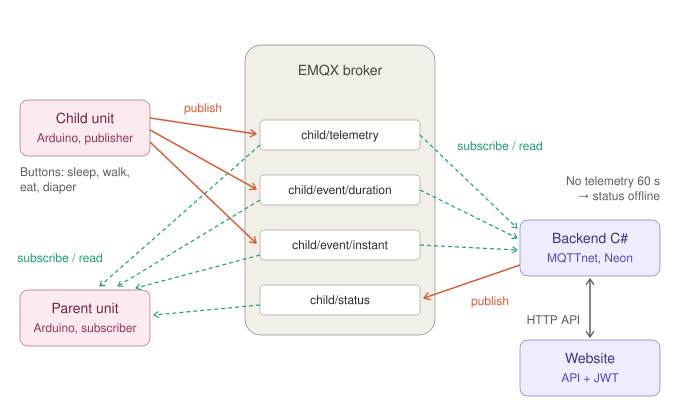

# Børnemonitor – struktur og funktionalitet

*Forslag fra Andrii. [Projektbeskrivelsen](PROJEKTBESKRIVELSE.md) siger **hvad**, denne fil **hvordan**.*

Navne i kode, topics, endpoints og databasen er på engelsk (`child`, `parent`, `measurement` …).

## Beslutninger

| # | Spørgsmål | Status |
|---|---|---|
| 1 | MQTT eller HTTP? | ✅ MQTT (EMQX Cloud) |
| 2 | Hvem tjekker grænseværdierne? | ✅ Backend (sættes på hjemmesiden) |
| 3 | Hvor trykker man på hændelser (søvn, gåtur …)? | ✅ På børneenheden, med TOUCH0 holdt nede ([Tetiana](Funktioner%20i%20barnets%20Arduino)) |
| 4 | Hvad gør forældreenheden? | ❓ Åben |
| 5 | MVP og nice to have? | ❓ Åben – forslag nedenfor |

## Enhederne

- **Børneenhed** – sender temperatur, fugt og lys hvert 20. sekund og hændelser (søvn, gåtur, madning, ble-skift) fra knapperne. Detaljer: [Funktioner i barnets Arduino](Funktioner%20i%20barnets%20Arduino) (Tetiana).
- **Forældreenhed** – *ikke afklaret.* Forslag: viser måling og alarm, lydalarm ved advarsel og når børneenheden er offline.
- **Backend (C#, Docker)** – gemmer i Neon, tjekker grænser og online/offline, sender advarsler og indstillinger, API + JWT.
- **Hjemmeside** – målinger, grafer, dagbog, indstillinger.

Tiden sættes af Arduinoen (RTC, synkroniseret via NTP) og sendes som `timestamp` i UTC.

## Kommunikation: MQTT

**Valgt: MQTT** via EMQX Cloud (Serverless, gratis): `f2ba9612.ala.eu-central-1.emqxsl.com`, port `8883` (TLS). Login deles ikke i Git.

### Hvorfor MQTT og ikke HTTP

Få beskeder, så mængden kræver ikke MQTT. Forskellen er advarsler til forældreenheden:

| | HTTP | MQTT |
|---|---|---|
| Advarsel | Polling hvert 3.–5. sek. | Med det samme |
| Kompleksitet | Lavere | Højere (broker) |

### Dataflow

Man abonnerer på et topic hos brokeren, ikke på en enhed.

| Hvem | Publicerer | Abonnerer på |
|---|---|---|
| Børneenhed | `child/telemetry`, `child/event/duration`, `child/event/instant` | – |
| Forældreenhed | *ikke afklaret* | forslag: `child/telemetry`, `alarm`, `settings` |
| Backend | `alarm`, `settings` (retained) | `child/#` |
| Hjemmeside | – | – (bruger backendens API) |

- Backend gemmer **alle** målinger (til grafer). Grænsen afgør kun, om der også sendes alarm.
- Alarm sendes én gang, når grænsen overskrides, og "ok", når værdien er normal igen – ikke ved hver måling.
- **Offline:** børneenheden sender ingen status og ingen *last will*. Backend markerer den som offline, når der ikke er kommet telemetri i 60 sek. (3 × 20 sek.).

### Beskedformat (JSON)

Fra børneenheden: se [MQTT topics](MQTT%20topics) (Tetiana). Vigtigt for backend:

- `timestamp` kommer fra Arduinoen (UTC) – backend gemmer den, ikke modtagelsestidspunktet.
- Ved mistet forbindelse gemmer Arduinoen hændelser i en kø og sender dem senere med det oprindelige `timestamp` → gamle beskeder er normale.
- `event_id` er det samme ved `start` og `stop` for `sleep`/`walk` → dubletter (QoS 1, kø) genkendes på `event_id`.

Fra backend (forslag):

| Topic | Eksempel |
|---|---|
| `alarm` | `{"type": "temp", "state": "high"}` / `{"type": "offline", "state": "high"}` / `… "state": "ok"` – `type`: `temp`, `humidity`, `offline` |
| `settings` (retained) | `{"tempMax": 24, "humidityMax": 60, "walkMinutes": 30}` |

**Skal afklares med Tetiana:**

- Prefix: `child/telemetry` eller `babymonitor/family1/child/telemetry`?
- Type af `event_id`: tal eller tekst?

## MVP – 4. december

- Målinger → backend → database.
- Advarsel ved høj temperatur/fugt.
- Alarm ved mistet forbindelse.
- Tilstande i dagbogen.
- JWT-login.

**Nice to have:** PDF-statistik, billeder, flere forældreenheder, påmindelser.
